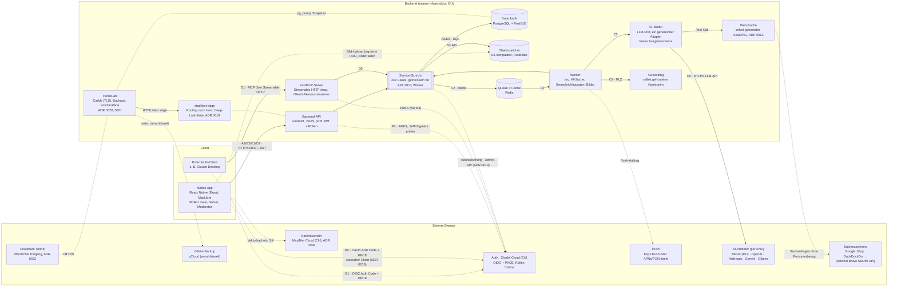
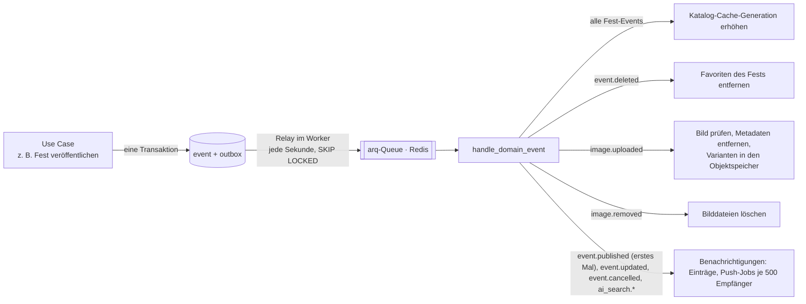
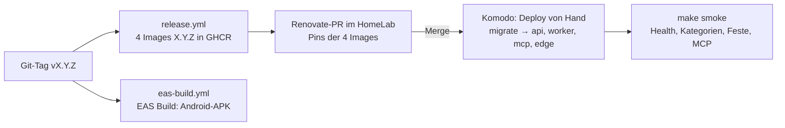

# Systemarchitektur

Markdown-Fassung von [`00-Design.pdf`](00-Design.pdf) (C4-Container-Ebene). Die Flows A–D stimmen mit dem Diagramm und mit CLAUDE.md „Core flows“ überein. Die Entscheidungen dazu stehen in [`25-adr/`](../25-adr/0001-adrs-verwenden.md).

**Betrieb:** Der Kern läuft als Stack `stadtfest` im HomeLab auf einem eigenen Server in der EU ([ADR 0019](../25-adr/0019-produktionsstack.md)). Externe Dienste sind per ENV austauschbar (DSGVO: Kern in der EU, Rest per ENV).

## Container

Alle HTTPS-Verbindungen von App, MCP-Client und Bild-Uploads laufen über den Cloudflare Tunnel zum HomeLab-Caddy und von dort zu `stadtfest-edge` (Hosts `stadtfest.`, `stadtfest-api.`, `stadtfest-mcp.`, `stadtfest-bilder.herderstreet.de`), das an API, MCP-Server und Objektspeicher weiterleitet. Kein Dienst hat eingehende Ports.

## Flows

| Flow | Schritte |
|---|---|
| **A · Suche als Gast** | A1 App → API ohne Token · A2 PostGIS-Umkreisabfrage → Ergebnisliste und Karte (Redis-Cache 5 min) |
| **B · Anmeldung** | B1 App ↔ Zitadel (OIDC, PKCE) → Token · B2 App sendet JWT an die API · B3 API prüft JWT per JWKS und liest Rollen aus den Claims. Kontolöschung: API löscht lokale Daten und den Nutzer über die Admin-API des IdP, bei Fehler per Worker-Retry (ADR 0010) |
| **C · KI-Suche per PLZ** | C1 Moderator stößt die Suche an (PLZ, optional Filter aus festen Werten, R10c), API legt einen Auftrag an (`202`) · C2 Auftrag in die Queue (über die Outbox, ADR 0005) · C3 Worker übernimmt · C4 Geocoding PLZ → Umkreis · C5 KI-Modul mit Festschema · C6 KI-Anbieter mit Web-Suche → validiertes JSON · C7 Speichern als **Entwurf** (Quelle geprüft, Duplikate und verworfene Quellen übersprungen) · C8 Moderator prüft und gibt frei; die App fragt den Status alle 10 s ab. LLM-Adapter: Pydantic AI (ADR 0012), Web-Suche: selbst gehostetes SearXNG (ADR 0013), Nicht-EU-LLM optional (ADR 0014) |
| **D · MCP** | D1 externer KI-Client → FastMCP (Streamable HTTP unter `/mcp`, zustandslos). `search_events` und `get_event` gehen ohne Token. `start_ai_search` ohne Token ergibt `401` mit Protected Resource Metadata (RFC 9728) → D0 Anmeldung bei Zitadel mit statischem OAuth-Client (PKCE, ADR 0018) → erneuter Aufruf mit Token, geprüft wie B3 · D2 Service-Schicht: dieselben Use Cases wie REST, Rollen im Use Case · D3 Datenbank. Rate-Limit 60 Aufrufe/min je Token bzw. IP |

## Ausgabeschema der KI-Suche (C5)

`name`, `date_from`, `date_to`, `place`, `address`, `coordinates`, `category`, `source_url`, `description`, ab `EventDraftV2` (R10c) zusätzlich `website_url`, `opening_hours` (je Tag) und `price`. Das Schema ist versioniert im Code und wird vor dem Speichern validiert. Ohne überprüfbare `source_url` wird ein Fund verworfen; eine nicht belegte Website wird nur geleert. Optionale Filter des Moderators (Zeitraum, Kategorien, Umkreis, feste Suchschwerpunkte, R10c) grenzen Prompt und Prüfung ein; einen Freitext gibt es nicht.

## Domain-Events über die Outbox (ab R07, ADR 0005)

- Jede Änderung eines Fests in der Moderation schreibt ihr Domain-Event (`event.published`, `event.updated` mit `changedFields`, `event.unpublished`, `event.cancelled`, `event.deleted`) **in derselben Transaktion** in die Tabelle `outbox`. Der Payload enthält nur IDs und Feldnamen.
- Das Relay läuft als Hintergrundschleife im Worker-Prozess, sperrt offene Einträge mit `FOR UPDATE SKIP LOCKED`, reiht sie mit der Event-ID als Job-ID in arq ein und markiert sie als versendet. Zustellung „at least once“; die Konsumenten sind idempotent.
- Versendete Einträge löscht ein täglicher Job nach 14 Tagen (03:30 Uhr).
- Ab R08 laufen auch Bild-Events über die Outbox (`image.uploaded`, `image.removed`, [ADR 0011](../25-adr/0011-bildauslieferung.md)). Die App lädt Fotos mit signierter URL direkt in den Objektspeicher und lädt Varianten direkt aus dessen öffentlichem Präfix `public/`. Ein täglicher Job (03:45 Uhr) räumt verwaiste Uploads und Bilder gelöschter Feste auf.

## Betrieb und Release (R16, ADR 0019)

- Stack: HomeLab `stacks/stadtfest/compose.yaml`; Umgebungsvertrag des Backends: [`infra/komodo-environment.example`](../../infra/komodo-environment.example); Anleitung: [deployment-komodo.md](../40-operations/deployment-komodo.md).
- Rollback: vorherigen Tag deployen; Migrationen nur rückwärtskompatibel (Expand/Contract).
- Backups und Alarme kommen aus dem HomeLab ([backup-restore.md](../40-operations/backup-restore.md), [monitoring.md](../40-operations/monitoring.md)).

## Abbildung im Code

| Container | Einstiegspunkt | Paket |
|---|---|---|
| Backend-API | `uvicorn stadtfest.bootstrap.app:create_app --factory` | `adapters/inbound/rest` |
| Worker | `python -m stadtfest.bootstrap.worker` | `adapters/inbound/worker` |
| FastMCP-Server | `python -m stadtfest.bootstrap.mcp` (Image `stadtfest-mcp`, Port 8001) | `adapters/inbound/mcp`; Bearer-Prüfung gemeinsam mit REST in `adapters/inbound/auth` |
| Service-Schicht | – | `application/<context>` + `domain/<context>`; Kontexte `events`, `collections`, `ai_ingestion`, `moderation`, `notifications` (ADR 0016) |
| Datenbank, Objektspeicher, Redis, KI-Modul, Geocoding, Push | – | `adapters/outbound/<tech>` (hinter Ports) |
| Migration (Container `stadtfest-migrate`) | `alembic upgrade head` (Image `stadtfest-backend`) | `backend/migrations` |
| Routing + Deep-Link-Seite (`stadtfest-edge`) | Image `stadtfest-edge` | `infra/edge/` (Caddyfile, `public/`) |
| Web-Suche (`stadtfest-searxng`) | Image `stadtfest-searxng` | `infra/searxng/` |
| Stack, Backups, Logs + Alarme | HomeLab | `github.com/Harpune/HomeLab`: `stacks/stadtfest/`, `scripts/backup-*.{sh,py}`, `stacks/monitoring/` |
| Smoke-Test | `python -m stadtfest.bootstrap.smoke` (`make smoke`) | `bootstrap/smoke.py` |

Lokal ersetzt Keycloak Zitadel (ADR 0003) und SeaweedFS den Objektspeicher (ADR 0007).
